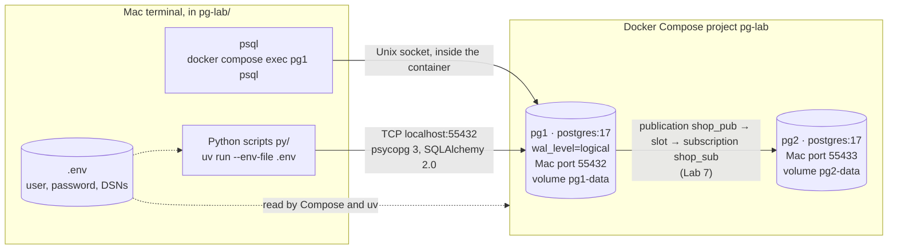

# PostgreSQL hands-on lab: SQL, Python, internals and CDC

A hands-on lab that runs two PostgreSQL 17 databases in Docker on a Mac and works through eight labs: SQL basics, advanced SQL, Python with psycopg 3 and SQLAlchemy 2.0, MVCC, the write-ahead log and VACUUM, the query planner, and logical replication. Every step explains the idea in plain words, shows readable code, walks through it line by line, and says exactly what output to expect and what it means. The dataset is generated with arithmetic instead of random numbers, so a reader's results match the docs.

**Why.** Most PostgreSQL problems in production come from the parts that tutorials skip: a transaction left open that stops VACUUM, a bad row estimate that picks the wrong join, a replication slot that fills the disk. This lab makes each of those happen on purpose, on a laptop, and shows how to see it in the system catalogs, `EXPLAIN` and the WAL. The last lab connects the same machinery to change data capture with Debezium.

## Results

- The seed script loads 610,201 rows (200 products, 10,000 customers, 200,000 orders, 400,001 order lines) and produces the same data on every run; the integration tests check those counts and every output line of the four Python scripts ([`tests/`](tests)).
- Bulk loading 50,000 rows with `COPY` took 0.03 s against 0.34–0.36 s for `executemany`, 11–14× faster across four runs ([chapter 03, step 3.4](docs/03-python.md#34-loading-and-reading-lots-of-rows)).
- Measured on an Apple M4 Max with Docker Desktop (16 CPUs, 47 GiB VM) and synthetic data. Timings depend on the machine and on Docker's network layer; the row counts and query results do not.
- Limitation: this is a single-laptop lab, not a production setup. Lab 7 runs real logical replication between the two containers, but [step 7.6](docs/07-replication-cdc.md#76-how-debezium-uses-the-same-machinery) only maps Debezium's settings onto what the lab did; no Debezium or Kafka runs here.

## Architecture



| Decision | Choice | Why |
| --- | --- | --- |
| Database | Two `postgres:17` containers in [`compose.yaml`](compose.yaml) | No local install; pinned major version (the 18 image moved its data directory); pg2 is the replication target in Lab 7 |
| Ports | 55432 (pg1) and 55433 (pg2) | Avoid a clash with a Postgres already on 5432 |
| psql | Runs inside the containers, with a per-container prompt ([`psqlrc/`](psqlrc)) | Nothing to install on the Mac; `pg1 labdb=#` and `pg2 labdb=#` are impossible to confuse |
| Data | [`sql/seed.sql`](sql/seed.sql): arithmetic with `generate_series` | Deterministic: every reader gets the same rows, plans and numbers |
| Settings | `.env` (git-ignored) from [`.env.example`](.env.example), read by Compose and by `uv run --env-file` | No credentials in code; one place to change them |
| Python | uv project, Python 3.13, psycopg 3 and SQLAlchemy 2.0 ([`py/`](py)) | The current standard driver and ORM; `uv.lock` pins every version |
| Code quality | Ruff (broad rule set), Pyright strict, pytest against a real Postgres, Gitleaks, pre-commit | The teaching scripts stay correct and the docs' outputs stay true |
| Replication | `wal_level=logical`, publication and subscription between the two containers | Shows the slot mechanics that Debezium and other CDC tools rely on |

## Chapters

Plan on 5–6 hours. Each lab builds on the state the previous one left.

| # | Chapter | Covers |
| --- | --- | --- |
| 00 | [Setup](docs/00-setup.md) | Clone, `.env`, the Compose file, psql prompts, starting and connecting |
| 01 | [SQL basics](docs/01-sql-basics.md) | Tables and constraints, `RETURNING`, transactions, the 200,000-order dataset |
| 02 | [Advanced SQL](docs/02-advanced-sql.md) | Joins and anti-joins, CTEs and window functions, JSONB, upserts, foreign-key indexes |
| 03 | [Python](docs/03-python.md) | psycopg 3 parameters and transactions, `COPY`, server-side cursors, the SQLAlchemy 2.0 ORM |
| 04 | [MVCC](docs/04-mvcc.md) | `xmin`, `xmax`, `ctid`, `pageinspect`, row locks, isolation levels |
| 05 | [WAL and VACUUM](docs/05-wal-and-vacuum.md) | LSNs, `pg_walinspect`, full-page images, pruning, bloat, VACUUM, autovacuum |
| 06 | [The query planner](docs/06-query-planner.md) | `EXPLAIN (ANALYZE, BUFFERS)`, statistics, scan and join types, extended statistics |
| 07 | [Replication and CDC](docs/07-replication-cdc.md) | `test_decoding`, replica identity, slots, publication and subscription, failure modes, Debezium |
| 08 | [How it fits together](docs/08-how-it-fits-together.md) | Databases, files, 8 KB pages, shared buffers and WAL, and which lab showed each |
| — | [Cleanup and troubleshooting](docs/cleanup-and-troubleshooting.md) | Teardown in the right order, symptoms and fixes |

## Quickstart

Prerequisites: Docker Desktop (running), [uv](https://docs.astral.sh/uv/) and Git. [Chapter 00](docs/00-setup.md) explains each step.

```bash
git clone https://github.com/morillo/postgres-hands-on-lab.git pg-lab
cd pg-lab
cp .env.example .env
docker compose up -d --wait
```

```bash
docker compose exec pg1 psql -U lab -d labdb
```

## Development

Setup: `uv sync`. The same checks run in CI ([`.github/workflows/ci.yml`](.github/workflows/ci.yml)) on every push to `main` and every pull request.

```bash
uv sync
```

Lint and format check:

```bash
uv run ruff check .
uv run ruff format --check .
```

Type check (Pyright strict, the engine behind VS Code's Pylance):

```bash
uv run pyright
```

Integration tests. They need pg1 running (see the Quickstart) and they **drop and re-create the shop tables**, so run them on a fresh database, not in the middle of a lab:

```bash
uv run --env-file .env pytest -v
```

Install the git hooks once (Ruff, Pyright, Gitleaks and file hygiene run on each commit), or run them on demand:

```bash
uv run pre-commit install
uv run pre-commit run --all-files
```

## Repository layout

```
.
├── compose.yaml          # pg1 and pg2, postgres:17, ports 55432/55433, healthchecks
├── .env.example          # lab settings; copy to .env (git-ignored)
├── psqlrc/               # pg1 and pg2 psql prompts, mounted as /root/.psqlrc
├── sql/
│   ├── schema.sql        # the four shop tables from step 1.1
│   └── seed.sql          # deterministic dataset from step 1.8
├── py/
│   ├── settings.py       # reads PG_DSN and SA_URL from the environment
│   ├── 01_basics.py      # step 3.2: queries, parameters, row factories
│   ├── 02_transactions.py# step 3.3: autocommit, transaction blocks, savepoints
│   ├── 03_bulk.py        # step 3.4: executemany vs COPY, server-side cursor, CSV export
│   └── 04_orm.py         # step 3.5: SQLAlchemy 2.0 ORM
├── tests/                # pytest integration tests against a real PostgreSQL 17
├── docs/                 # the chapters; diagrams in docs/images/
├── pyproject.toml        # uv project, Ruff and pytest configuration
├── pyrightconfig.json    # Pyright strict
└── .pre-commit-config.yaml
```

## License

[Apache-2.0](LICENSE)
