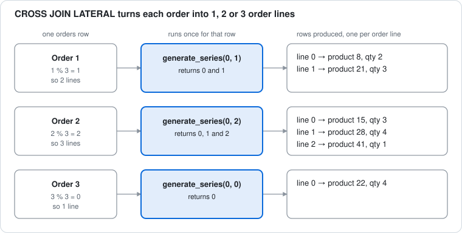

# 01 — SQL basics

**The idea.** A relational database stores data in tables and enforces rules about it. In this lab you create four tables for a small shop (customers, products, orders, order lines), break each type of rule on purpose to see how Postgres protects the data, practise changing data, and learn transactions. At the end you load a large dataset that the later labs use.

**Where:** psql on pg1 (`pg1 labdb=#`), until step 1.8.

## 1.1 Create the tables

**The idea.** A table definition lists the columns, the type of each, and the rules (constraints) every row must obey. Postgres rejects any change that would break a rule, so bad data never gets in.

Paste the whole block at the psql prompt. (The same four statements are saved in `sql/schema.sql`, which the repository's automated tests use to build the tables.)

```sql
-- pg1 psql
CREATE TABLE customers (
    id          bigint GENERATED ALWAYS AS IDENTITY PRIMARY KEY,
    email       text NOT NULL UNIQUE,
    name        text NOT NULL,
    country     char(2) NOT NULL,
    created_at  timestamptz NOT NULL DEFAULT now()
);

CREATE TABLE products (
    id     bigint GENERATED ALWAYS AS IDENTITY PRIMARY KEY,
    sku    text NOT NULL UNIQUE,
    name   text NOT NULL,
    price  numeric(10,2) NOT NULL CHECK (price > 0),
    attrs  jsonb NOT NULL DEFAULT '{}'
);

CREATE TABLE orders (
    id           bigint GENERATED ALWAYS AS IDENTITY PRIMARY KEY,
    customer_id  bigint NOT NULL REFERENCES customers (id),
    status       text NOT NULL DEFAULT 'new'
                 CHECK (status IN ('new', 'paid', 'shipped', 'cancelled')),
    ordered_at   timestamptz NOT NULL DEFAULT now()
);

CREATE TABLE order_items (
    order_id    bigint NOT NULL REFERENCES orders (id) ON DELETE CASCADE,
    product_id  bigint NOT NULL REFERENCES products (id),
    qty         integer NOT NULL CHECK (qty > 0),
    unit_price  numeric(10,2) NOT NULL,
    PRIMARY KEY (order_id, product_id)
);
```

**The column types:**

| Type | Holds | Why this type |
| --- | --- | --- |
| `bigint` | Whole numbers up to about 9 quintillion | Ids that will never run out |
| `integer` | Whole numbers up to about 2.1 billion | Quantities |
| `text` | Text of any length | Names, emails, codes. In Postgres `text` is as fast as `varchar(n)`; use a `CHECK` if you need a length limit. |
| `char(2)` | Exactly 2 characters | Two-letter country codes such as `US` |
| `numeric(10,2)` | Exact decimals: up to 10 digits, 2 after the decimal point | Money. A `float` type would round, so 0.1 + 0.2 would not equal 0.3. |
| `timestamptz` | A moment in time, with time zone | Stored internally in UTC and shown in your session's time zone, so one moment is never ambiguous |
| `jsonb` | A JSON document, stored in a parsed binary form | Flexible product attributes (Lab 2) |

**The rules (constraints):**

| Rule | Meaning |
| --- | --- |
| `NOT NULL` | The column must have a value. NULL is SQL's word for "no value". |
| `PRIMARY KEY` | The column (or set of columns) identifies each row: unique and never NULL. `order_items` uses two columns together: one product appears at most once per order. |
| `UNIQUE` | No two rows may share the value. Two customers cannot have the same email. |
| `CHECK (condition)` | Every row must make the condition true. Prices above 0; status one of four words. |
| `REFERENCES customers (id)` | A **foreign key**: the value must exist as an `id` in `customers`. An order cannot belong to a customer who does not exist. |
| `ON DELETE CASCADE` | When an order is deleted, delete its order lines too. Without this (as on `orders → customers`), Postgres refuses to delete a customer who still has orders. |
| `DEFAULT now()` | If an insert leaves the column out, use this value. `now()` is the current time. |
| `GENERATED ALWAYS AS IDENTITY` | Postgres numbers the rows itself: 1, 2, 3 … from an internal counter called a sequence. `ALWAYS` means you may not type your own id. |

Postgres automatically builds an index (a lookup structure, covered in Lab 2) for every primary key and unique column, but not for foreign keys.

**You should see** `CREATE TABLE` four times. Then list the tables:

```sql
-- pg1 psql
\dt
```

It lists `customers`, `order_items`, `orders` and `products`, all owned by `lab`.

## 1.2 Insert rows and get the new ids back

```sql
-- pg1 psql
INSERT INTO customers (email, name, country)
VALUES ('ana@example.com',  'Ana Pérez',  'VE'),
       ('ben@example.com',  'Ben Okafor', 'US'),
       ('chen@example.com', 'Chen Wei',   'SG')
RETURNING id, email, country;

INSERT INTO products (sku, name, price, attrs)
VALUES ('SKU-A1', 'Mechanical keyboard', 129.00, '{"category": "tools", "color": "black"}'),
       ('SKU-B2', 'Noise-cancelling headphones', 249.50, '{"category": "audio", "color": "blue"}')
RETURNING id, sku, price;
```

Line by line:

- `INSERT INTO customers (email, name, country)` names the table and the columns you are supplying. `id` and `created_at` are left out, so Postgres fills them: `id` from the identity counter, `created_at` from its `DEFAULT now()`.
- `VALUES (…), (…), (…)` gives three rows in one statement. Text values go in single quotes.
- `RETURNING id, email, country` makes the `INSERT` hand back those columns of the rows it just inserted, like a `SELECT`. This is how a program learns the ids Postgres generated, without a second query.
- The `attrs` value is a JSON document written as text in single quotes; Postgres parses it into `jsonb`.

**You should see:**

```
 id |      email       | country
----+------------------+---------
  1 | ana@example.com  | VE
  2 | ben@example.com  | US
  3 | chen@example.com | SG
(3 rows)

INSERT 0 3
 id |  sku   | price
----+--------+--------
  1 | SKU-A1 | 129.00
  2 | SKU-B2 | 249.50
(2 rows)

INSERT 0 2
```

The ids were numbered 1, 2, 3 by Postgres. Each table has its own counter, so the products also start at 1.

## 1.3 Break every rule on purpose

**The idea.** Seeing each rejection teaches you what each constraint protects, and what the error messages look like when your own code breaks one.

Run these five statements one at a time. Every one of them fails, and that is the point.

```sql
-- pg1 psql
INSERT INTO customers (email, name, country) VALUES ('ana@example.com', 'Ana Again', 'VE');
INSERT INTO products (sku, name, price) VALUES ('SKU-X', 'Free thing', 0);
INSERT INTO orders (customer_id) VALUES (999);
INSERT INTO orders (customer_id, status) VALUES (1, 'lost');
INSERT INTO customers (id, email, name, country) VALUES (50, 'x@example.com', 'X', 'US');
```

**You should see** these errors, in this order:

| Statement | Error message | Rule it broke |
| --- | --- | --- |
| Second customer with Ana's email | `duplicate key value violates unique constraint "customers_email_key"` | `UNIQUE` on `email` |
| Product priced at 0 | `new row for relation "products" violates check constraint "products_price_check"` | `CHECK (price > 0)` |
| Order for customer 999 | `insert or update on table "orders" violates foreign key constraint "orders_customer_id_fkey"` | Foreign key: customer 999 doesn't exist |
| Order with status `lost` | `new row for relation "orders" violates check constraint "orders_status_check"` | `CHECK (status IN …)` |
| Customer with id 50 typed in | `cannot insert a non-DEFAULT value into column "id"`, with a hint about `OVERRIDING SYSTEM VALUE` | `GENERATED ALWAYS AS IDENTITY` |

Postgres names each constraint for you: table, column, then a suffix (`_key` for unique, `_check`, `_fkey` for foreign key, `_pkey` for primary key).

Under most errors psql prints a `DETAIL:` line showing the rejected row. Two things in them are worth noticing:

- In the fourth error the row includes a timestamp, the `ordered_at` default `now()`. That is the moment you ran it, so it will not match anyone else's.
- In the second error the row reads `Failing row contains (3, SKU-X, …)`. The product had already taken id **3** from the counter before the price check rejected it. The counter does not give numbers back when an insert fails, so failed inserts leave gaps in the ids. The first four failures used up customer id 4, product id 3, and order ids 1 and 2. You see the effect in the next step.

## 1.4 Create an order and its lines in one statement

**The idea.** An order and its lines belong together. A **CTE** (common table expression: a named, temporary result introduced with `WITH`) can pass the new order's id straight into the insert of its lines, all in one statement.

```sql
-- pg1 psql
INSERT INTO customers (email, name, country)
VALUES ('dana@example.com', 'Dana Silva', 'BR')
RETURNING id;

WITH new_order AS (
    INSERT INTO orders (customer_id) VALUES (1)
    RETURNING id
)
INSERT INTO order_items (order_id, product_id, qty, unit_price)
SELECT new_order.id, products.id, 1, products.price
FROM new_order
CROSS JOIN products
RETURNING order_id, product_id, qty, unit_price;
```

Line by line, for the second statement:

1. `WITH new_order AS ( … )` runs the inner `INSERT` first and names its output `new_order`. Because of `RETURNING id`, `new_order` behaves like a one-row table holding the new order's id.
2. `INSERT INTO order_items (…)` inserts whatever rows the `SELECT` below produces.
3. `FROM new_order CROSS JOIN products` pairs the one `new_order` row with every row in `products`. A `CROSS JOIN` combines every row on the left with every row on the right; one order times two products gives two rows.
4. `SELECT new_order.id, products.id, 1, products.price` builds each order line: the new order's id, the product's id, quantity 1, and the product's current price. Writing `table.column` says which table each column comes from.
5. `RETURNING …` shows the lines that were inserted.

The whole statement is one unit: if any part fails, nothing is inserted.

**You should see** Dana get id **5**, not 4, and the order get id **3**, not 1, because of the gaps from step 1.3:

```
 order_id | product_id | qty | unit_price
----------+------------+-----+------------
        3 |          1 |   1 |     129.00
        3 |          2 |   1 |     249.50
(2 rows)
```

If you skipped or repeated a failing statement in 1.3, your ids differ. Nothing later depends on them.

## 1.5 Read data back with joins and totals

**The idea.** Related data lives in separate tables. A **join** combines rows from two tables where a condition matches, and `GROUP BY` collapses many rows into one per group so you can total them.

```sql
-- pg1 psql
SELECT orders.id     AS order_id,
       customers.name,
       orders.status,
       sum(order_items.qty * order_items.unit_price) AS total
FROM orders
JOIN customers   ON customers.id = orders.customer_id
JOIN order_items ON order_items.order_id = orders.id
GROUP BY orders.id, customers.name, orders.status;
```

Line by line:

1. `FROM orders` starts from the orders table.
2. `JOIN customers ON customers.id = orders.customer_id` attaches to each order the customer whose `id` equals the order's `customer_id`.
3. `JOIN order_items ON order_items.order_id = orders.id` attaches each order's lines. An order with two lines now appears as two rows.
4. `GROUP BY orders.id, customers.name, orders.status` collapses those rows back to one per order. Every column you `SELECT` must either be in the `GROUP BY` or be inside an aggregate function such as `sum`.
5. `sum(order_items.qty * order_items.unit_price)` adds up quantity × price over each group's rows.
6. `AS order_id`, `AS total` rename the output columns.

**You should see** one row: `3 | Ana Pérez | new | 378.50` (129.00 + 249.50).

A simpler filtered read:

```sql
-- pg1 psql
SELECT id, name, country
FROM customers
WHERE country IN ('US', 'VE')
ORDER BY name;
```

`WHERE` keeps only the rows where the condition is true; `IN ('US', 'VE')` means "equal to any value in the list". `ORDER BY name` sorts alphabetically. Without `ORDER BY`, SQL promises no particular order. **You should see** Ana Pérez (VE) then Ben Okafor (US).

## 1.6 Change and delete rows

```sql
-- pg1 psql
UPDATE orders SET status = 'paid' WHERE id = 3 RETURNING id, status;
DELETE FROM customers WHERE email = 'chen@example.com' RETURNING id, name;
DELETE FROM customers WHERE id = 1;
```

- `UPDATE orders SET status = 'paid' WHERE id = 3` changes one column of the rows the `WHERE` matches. Without a `WHERE`, it would change every row in the table.
- `DELETE FROM customers WHERE …` removes matching rows. Chen has no orders, so nothing stops it.
- The last statement tries to delete Ana, who has an order.

**You should see** `3 | paid`, then `3 | Chen Wei`, then an error:

```
ERROR:  update or delete on table "customers" violates foreign key constraint "orders_customer_id_fkey" on table "orders"
DETAIL:  Key (id)=(1) is still referenced from table "orders".
```

The foreign key protects in both directions: you cannot create an order for a missing customer (step 1.3), and you cannot remove a customer who still has orders.

## 1.7 Transactions: all or nothing

**The idea.** A **transaction** groups statements so they either all take effect or none do. Moving money between two accounts is the classic example: the debit and the credit must happen together. Outside an explicit transaction, Postgres wraps every single statement in its own transaction and commits it immediately; this is called autocommit.

| Command | Meaning |
| --- | --- |
| `BEGIN` | Start a transaction. Nothing you change is visible to other sessions, or permanent, yet. |
| `COMMIT` | Make every change since `BEGIN` permanent and visible. |
| `ROLLBACK` | Throw away every change since `BEGIN`. |

```sql
-- pg1 psql
BEGIN;
UPDATE products SET price = price * 0.5 WHERE sku = 'SKU-A1';
SELECT sku, price FROM products ORDER BY sku;
```

**You should see** the prompt change to `pg1 labdb=*#`; the `*` means a transaction is open. SKU-A1 shows the halved price, `64.50`. Now undo it:

```sql
-- pg1 psql
ROLLBACK;
SELECT sku, price FROM products ORDER BY sku;
```

**You should see** the prompt back to `pg1 labdb=#` and SKU-A1 at `129.00` again. The change never became permanent.

An error inside a transaction spoils the whole transaction:

Run this in **two parts**, so you can see the prompt in between. First part, up to and including the division:

```sql
-- pg1 psql
BEGIN;
UPDATE products SET price = 99.00 WHERE sku = 'SKU-A1';
SELECT 1 / 0;
```

**You should see** `BEGIN`, `UPDATE 1`, then `ERROR:  division by zero`, and the prompt changes to `pg1 labdb=!#`. The `!` means the transaction has failed.

Why two parts: psql draws the prompt only when it is waiting for your next line. If you paste the whole sequence at once, psql runs every statement first, the final `COMMIT` ends the transaction, and only then is the prompt drawn, so it is back to `=#` and you never see the `!`.

Second part:

```sql
-- pg1 psql
SELECT sku, price FROM products;
COMMIT;
```

**You should see**, in order:

1. `ERROR:  current transaction is aborted, commands ignored until end of transaction block` for the `SELECT`. Once a transaction fails, Postgres refuses every further statement in it.
2. `ROLLBACK` printed in response to your `COMMIT`. Postgres will not commit a failed transaction; it rolls it back instead, and the price update is lost along with everything else. The prompt returns to `pg1 labdb=#`.

Check:

```sql
-- pg1 psql
SELECT sku, price FROM products WHERE sku = 'SKU-A1';
```

**You should see** `129.00`.

## 1.8 Load the lab dataset

**The idea.** Indexes, the planner and WAL only show interesting behaviour with volume. A script, `seed.sql`, empties the four tables and fills them with 200 products, 10,000 customers, 200,000 orders and about 400,000 order lines. Your hand-made rows from 1.2–1.7 are removed. The script can be run again at any time to get back to exactly this starting point.

Leave psql:

```sql
-- pg1 psql
\q
```

**Where:** Mac terminal, in `pg-lab`.

The script is already in the repository, in `sql/seed.sql`. Print it:

```bash
# Mac
cat sql/seed.sql
```

**You should see** the script:

```sql
-- seed.sql: empty the shop tables and load a fixed, repeatable dataset.
\echo 'Emptying tables...'
TRUNCATE order_items, orders, products, customers RESTART IDENTITY CASCADE;

\echo 'Loading 200 products...'
INSERT INTO products (sku, name, price, attrs)
SELECT 'SKU-' || lpad(CAST(n AS text), 4, '0'),
       'Product ' || n,
       (5 + (n * 37) % 495) + 0.99,
       jsonb_build_object(
           'category',  (ARRAY['books', 'games', 'tools', 'garden', 'audio'])[1 + n % 5],
           'color',     (ARRAY['red', 'green', 'blue', 'black'])[1 + n % 4],
           'weight_kg', round((n % 50) / 10.0 + 0.1, 1))
FROM generate_series(1, 200) AS n;

\echo 'Loading 10,000 customers...'
INSERT INTO customers (email, name, country, created_at)
SELECT 'user' || n || '@example.com',
       'Customer ' || n,
       (ARRAY['US', 'MX', 'VE', 'ES', 'DE', 'JP', 'BR', 'CA'])[1 + n % 8],
       timestamptz '2024-01-01 00:00+00' + n * interval '50 minutes'
FROM generate_series(1, 10000) AS n;

\echo 'Loading 200,000 orders...'
INSERT INTO orders (customer_id, status, ordered_at)
SELECT 1 + (n * 7919) % 10000,
       CASE WHEN n % 100 = 0 THEN 'new'
            WHEN n % 100 < 3 THEN 'cancelled'
            WHEN n % 100 < 10 THEN 'paid'
            ELSE 'shipped'
       END,
       timestamptz '2025-01-01 00:00+00' + n * interval '157 seconds'
FROM generate_series(1, 200000) AS n;

\echo 'Loading order lines...'
INSERT INTO order_items (order_id, product_id, qty, unit_price)
SELECT orders.id,
       products.id,
       1 + (orders.id + line_number) % 4,
       products.price
FROM orders
CROSS JOIN LATERAL generate_series(0, orders.id % 3) AS line_number
JOIN products ON products.id = 1 + (orders.id * 7 + line_number * 13) % 200;

ANALYZE;

SELECT (SELECT count(*) FROM products)    AS products,
       (SELECT count(*) FROM customers)   AS customers,
       (SELECT count(*) FROM orders)      AS orders,
       (SELECT count(*) FROM order_items) AS order_items;
```

**The building blocks the script uses:**

| Piece | What it does | Example |
| --- | --- | --- |
| `\echo 'text'` | psql prints the text; a progress message | `Loading 200 products...` |
| `TRUNCATE t1, t2 …` | Empties tables instantly (much faster than `DELETE`) |  |
| `RESTART IDENTITY` | Resets the id counters to 1, so every run produces the same ids |  |
| `CASCADE` | Also empties tables whose foreign keys point at these |  |
| `generate_series(1, 200) AS n` | Produces the numbers 1 to 200 as rows, one column named `n` | 1, 2, 3 … 200 |
| `INSERT … SELECT …` | Inserts every row the `SELECT` returns, instead of hand-written `VALUES` | 200 numbers → 200 products |
| `a % b` | Modulo: the remainder of dividing a by b | `7 % 5` = 2 |
| `'SKU-' \|\| text` | `\|\|` joins two pieces of text | `'SKU-' \|\| '0007'` = `SKU-0007` |
| `CAST(n AS text)` | Converts a value to another type, here a number to text | `7` → `'7'` |
| `lpad(text, 4, '0')` | Pads text on the left to 4 characters with zeros | `'7'` → `'0007'` |
| `ARRAY['a', 'b', 'c'][i]` | Builds a list and takes item number i. Postgres counts list positions from 1. | `ARRAY['US','MX'][2]` = `MX` |
| `jsonb_build_object('k1', v1, 'k2', v2)` | Builds a JSON object from key/value pairs | `{"color": "red", …}` |
| `timestamptz '2025-01-01 00:00+00'` | A timestamp literal; `+00` means UTC |  |
| `n * interval '157 seconds'` | An interval multiplied by a number; added to a timestamp it moves it forward | order 2 is 314 s after 2025-01-01 |
| `CASE WHEN … THEN … ELSE … END` | Picks a value by testing conditions top to bottom |  |
| `ANALYZE` | Samples every table and stores statistics the planner uses (Lab 6) |  |

**How each table's values come out:**

- **Products:** `n % 5` cycles 0–4, so `1 + n % 5` cycles 1–5 and picks the five categories in turn. Prices come from `(n * 37) % 495`, which scatters them between 8.99 and 499.99, every product at a different price. Consecutive products jump 37 apart and wrap around at 495, so neighbouring products are not priced alike.
- **Customers:** countries rotate through the 8-item list. Each customer was created 50 minutes after the previous one.
- **Order owner:** `1 + (n * 7919) % 10000`. Because 7919 shares no factor with 10,000, this formula hits every customer number exactly once per 10,000 orders, so every customer ends up with exactly 20 orders, scattered in time.
- **Order status:** out of every 100 orders, number 0 is `new`, 1–2 are `cancelled`, 3–9 are `paid`, the remaining 90 are `shipped`. That gives 2,000 new, 4,000 cancelled, 14,000 paid and 180,000 shipped. Lab 6 needs this uneven spread.
- **Order dates:** 157 seconds apart, spanning 2025-01-01 to 2025-12-30.
- **Order lines:** each order gets 1, 2 or 3 lines. How the script does that is walked through, with a diagram, right below this list.

**How the order lines are generated, step by step.** This is the trickiest statement in the seed, so here it is again:

```sql
INSERT INTO order_items (order_id, product_id, qty, unit_price)
SELECT orders.id,
       products.id,
       1 + (orders.id + line_number) % 4,
       products.price
FROM orders
CROSS JOIN LATERAL generate_series(0, orders.id % 3) AS line_number
JOIN products ON products.id = 1 + (orders.id * 7 + line_number * 13) % 200;
```

**Goal.** Give each of the 200,000 orders between 1 and 3 order lines, each line with a product and a quantity, using only arithmetic so the result is the same on every run.

**Step 1 — how many lines does an order get?** `orders.id % 3` is the remainder of the order id divided by 3, which is always 0, 1 or 2. `generate_series(0, that remainder)` counts from 0 up to it, both ends included, so it returns 1, 2 or 3 numbers. Each number becomes one order line, and the column holding it is named `line_number`.

| Order id | `orders.id % 3` | `generate_series(0, …)` returns | Lines |
| --- | --- | --- | --- |
| 1 | 1 | 0, 1 | 2 |
| 2 | 2 | 0, 1, 2 | 3 |
| 3 | 0 | 0 | 1 |
| 4 | 1 | 0, 1 | 2 |

The pattern 2, 3, 1 repeats for every three orders.

**Step 2 — why `CROSS JOIN LATERAL`?** Normally every table or function listed in `FROM` is computed on its own, independent of the others, and only then are their rows combined. That doesn't work here: the call `generate_series(0, orders.id % 3)` needs a value **from the current orders row**, and a different value for each row. `LATERAL` is the keyword that allows this. It says: the item on the right may use columns of the item on its left, and it is re-run once for every row on the left. `CROSS JOIN` then pairs that order row with every number the call returned. Each step runs once per row, like a loop inside a loop:

```
for each row in orders:
    for line_number in generate_series(0, row.id % 3):
        produce one row: (row.id, line_number)
```

The diagram shows it for the first three orders:



The highlighted middle column is the `LATERAL` part: one `generate_series` call per order, with a different upper limit each time.

**Step 3 — which product and how many?** Each produced row now has an order id and a line number, and two formulas turn them into a product and a quantity.

- **Product:** `1 + (orders.id * 7 + line_number * 13) % 200`. The remainder after dividing by 200 is 0 to 199, and `1 +` makes it a product id from 1 to 200, exactly the ids that exist. `JOIN products ON products.id = …` then fetches that product, so its `price` can be copied into `unit_price`.
- **Quantity:** `1 + (orders.id + line_number) % 4`, a number from 1 to 4.

Worked through for order 2, which has three lines:

| line\_number | Product: 1 + (2 × 7 + line × 13) % 200 | Quantity: 1 + (2 + line) % 4 |
| --- | --- | --- |
| 0 | 1 + (14 + 0) % 200 = **15** | 1 + 2 % 4 = **3** |
| 1 | 1 + (14 + 13) % 200 = **28** | 1 + 3 % 4 = **4** |
| 2 | 1 + (14 + 26) % 200 = **41** | 1 + 4 % 4 = 1 + 0 = **1** |

**Why one order never lists the same product twice.** Within an order, each extra line adds 13 to the product calculation, so its lines get products 13 and 26 positions apart. On a 200-position wheel those can never coincide. That matters because `order_items` has the primary key `(order_id, product_id)`: a repeated product in one order would be rejected as a duplicate.

Run it inside pg1:

```bash
# Mac
docker compose exec pg1 psql -U lab -d labdb -f /sql/seed.sql
```

`-f /sql/seed.sql` tells psql to run the file instead of opening an interactive prompt; `/sql` is your Mac's `sql/` folder seen from inside the container.

**You should see**, after a few seconds:

```
Emptying tables...
TRUNCATE TABLE
Loading 200 products...
INSERT 0 200
Loading 10,000 customers...
INSERT 0 10000
Loading 200,000 orders...
INSERT 0 200000
Loading order lines...
INSERT 0 400001
ANALYZE
 products | customers | orders | order_items
----------+-----------+--------+-------------
      200 |     10000 | 200000 |      400001
(1 row)
```

The 400,001 lines: 66,666 orders get 1 line, 66,667 get 2, and 66,667 get 3 (66,666 + 133,334 + 200,001).

---

Previous: [00 — Setup](00-setup.md) · [Back to the README](../README.md) · Next: [02 — Advanced SQL](02-advanced-sql.md)
