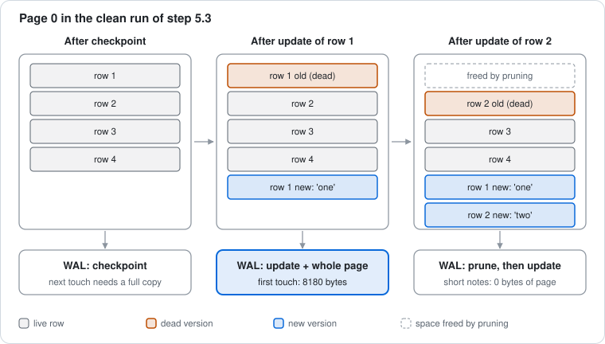

# 05 — Internals: WAL, dead rows and VACUUM

**The idea.** Two mechanisms keep Postgres both safe and tidy.

- **The write-ahead log (WAL).** Before Postgres changes a data page on disk, it first writes a description of the change to a sequential log, and a transaction counts as committed once its log records are safely on disk. The changed data pages themselves are written later, at leisure. After a crash, Postgres replays the log and loses nothing that committed. The same log feeds replication (Lab 7).
- **VACUUM.** MVCC (Lab 4) leaves dead row versions behind after every `UPDATE` and `DELETE`. VACUUM finds versions that no snapshot can see any more and marks their space as free for reuse.

In this lab you measure how much WAL a bulk insert writes, watch one `UPDATE` double a table's size, compare VACUUM with VACUUM FULL, and see an open transaction block the cleanup.

**Where:** psql on pg1, terminal A. Step 5.6 adds terminal B. If you closed terminal A's psql, reopen it:

```bash
# Mac, terminal A
docker compose exec pg1 psql -U lab -d labdb
```

Wait for the `pg1 labdb=#` prompt.

## 5.1 Positions in the log

```sql
-- pg1 psql, terminal A
SELECT pg_current_wal_lsn(), pg_walfile_name(pg_current_wal_lsn());
SHOW wal_segment_size;
```

- `pg_current_wal_lsn()` returns the current **LSN** (log sequence number): the byte position in the WAL where the next record will be written. Think of the WAL as one endless tape and the LSN as a position on it.
- `pg_walfile_name(lsn)` names the file on disk that holds that position.
- `wal_segment_size` is the size of each WAL file.

**You should see** (yours will differ) an LSN such as `0/1382E620`, a file name such as `000000010000000000000013`, and `16MB`.

**What it means.** An LSN is printed as two hexadecimal numbers separated by a slash: the high and low halves of one 64-bit byte position. The endless tape is cut into 16 MB files in the `pg_wal` folder; the file name says which piece of the tape the file holds. Subtracting two LSNs gives the number of bytes of WAL written between them, which is what the next step does.

## 5.2 How much WAL does a bulk insert write?

**The idea.** Record the LSN, run an insert, record the LSN again; the difference is the WAL the insert produced. To keep the two LSNs around, you store them in psql variables.

**psql variables.** `\gset` is a psql command that runs instead of the usual `;`: it executes the query and stores each output column in a psql variable named after the column. Later, `:'name'` pastes that variable's value into a query as a quoted text value.

| You type | psql does |
| --- | --- |
| `SELECT pg_current_wal_lsn() AS before \gset` | Runs the query, stores the result in a variable named `before`, prints nothing |
| `… pg_wal_lsn_diff(:'after', :'before')` | Replaces `:'after'` and `:'before'` with the stored values in quotes, for example `'0/1382E620'`, before sending the query |

The variables live in this psql session only; they disappear when you `\q`.

**Paste each block below separately, and wait for the prompt in between.** A `\gset` must be the last line you paste. When you paste several lines at once, psql can receive them as one long line. A backslash command such as `\gset` takes everything after it on its line as its own arguments, so the statements that follow would be swallowed and never run: you would see a row of `\gset: extra argument "…" ignored` warnings. Ending each paste at the `\gset` avoids that.

Block 1, create the table and record the starting position:

```sql
-- pg1 psql, terminal A
DROP TABLE IF EXISTS bloat;
CREATE TABLE bloat (id int PRIMARY KEY, payload text) WITH (autovacuum_enabled = false);
CREATE EXTENSION IF NOT EXISTS pg_walinspect;
SELECT pg_current_wal_lsn() AS before \gset
```

Block 2, insert the rows and record the end position:

```sql
-- pg1 psql, terminal A
INSERT INTO bloat SELECT n, repeat('x', 100) FROM generate_series(1, 100000) AS n;
SELECT pg_current_wal_lsn() AS after \gset
```

Block 3, compare:

```sql
-- pg1 psql, terminal A
SELECT pg_size_pretty(pg_wal_lsn_diff(:'after', :'before')) AS wal_written,
       pg_size_pretty(pg_relation_size('bloat'))            AS table_size;
```

Line by line:

1. `WITH (autovacuum_enabled = false)` turns off automatic vacuuming for this one table, so the background cleaner cannot change the numbers while you watch. Step 5.7 turns it back on.
2. `pg_walinspect` is an extension that can read and summarize the WAL; it is used just below.
3. The insert adds 100,000 rows, each with 100 `x` characters (`repeat('x', 100)`).
4. `pg_wal_lsn_diff(a, b)` returns the number of bytes between two LSNs. `pg_relation_size('bloat')` is the size of the table's data file.

**You should see** `INSERT 0 100000`, then about **22 MB** of WAL written for a **13 MB** table.

Why is the log bigger than the data? Break the WAL down by record type:

```sql
-- pg1 psql, terminal A
SELECT "resource_manager/record_type" AS record_type,
       count,
       pg_size_pretty(combined_size)  AS size
FROM pg_get_wal_stats(:'before', :'after', true)
WHERE count > 0
ORDER BY count DESC;
```

- `pg_get_wal_stats(start, end, true)` summarizes every WAL record between the two LSNs; `true` means "one row per record type" (`false` would group more coarsely).
- The column's real name contains a slash, `resource_manager/record_type`. A name with unusual characters must be written in **double** quotes. (Single quotes mean a text value; double quotes mean a name.)

**You should see**, approximately:

| record\_type | count | What it records |
| --- | --- | --- |
| `Heap/INSERT` | \~100,000 | One row added to the table ("heap" is Postgres's name for the table's data file) |
| `Btree/INSERT_LEAF` | \~100,000 | One entry added to the primary-key index |
| `Heap/INSERT+INIT` | a few hundred | A row added to a brand-new page, which is initialized in the same record |
| `Btree/SPLIT_R`, `Btree/INSERT_UPPER` | a few hundred | An index page filled up and was split in two |
| `Transaction/COMMIT` | 1 | The commit |

**What it means.** Each row costs two log records, one for the table and one for the index, and each record carries a header. Every index on a table adds WAL to every insert, which is one reason not to create indexes you don't need.

## 5.3 Full-page images after a checkpoint

**The idea.** Three facts combine here.

1. **Crash recovery starts at the last completed checkpoint.** A **checkpoint** guarantees that every page changed before it is safely on disk. After a crash, Postgres replays the WAL from the last checkpoint that finished. A checkpoint interrupted by the crash never counts.
2. **Data pages are written to disk at any time, not only during checkpoints.** Background processes write changed pages out continuously to free memory. A page write can therefore be cut off by a power failure at any moment.
3. **A cut-off write leaves a torn page.** A Postgres page is 8 KB, but the disk and operating system write in smaller pieces (often 4 KB). If power fails halfway, the page on disk is half new, half old: a mix that never existed.

The problem: a normal WAL record is a small **delta**, an instruction such as "in this page, replace row version 3 with these bytes". A delta only works when applied to an intact page. Applied to a torn page, it produces garbage.

The solution: the first time a page changes after a checkpoint, Postgres writes a copy of the **whole page** into the WAL (a **full-page image**). Replay starts at that checkpoint, so for every page changed since then, the WAL now holds a complete copy. Replay overwrites whatever is on disk, torn or not, with that copy, then applies the later deltas on top. Later changes to the same page therefore only need deltas. One full copy per page per checkpoint is enough, because replay never starts earlier than the last checkpoint.

| Time | Event | What is on disk or in the WAL |
| --- | --- | --- |
| 10:00 | Checkpoint completes | Page 7 on disk is intact |
| 10:01 | Row on page 7 updated | WAL gets a **full-page image** of page 7 |
| 10:02 | Page 7 updated again | WAL gets a small **delta** |
| 10:03 | Page 7 being written to disk; power fails halfway | Page 7 on disk is **torn** |
| Restart | Replay from the 10:00 checkpoint | 10:01 record: page 7 replaced by the full image. 10:02 record: delta applied on top. Page 7 is correct again. |

The test: force a checkpoint, change one row, then change a second row **on the same page**, and record the WAL position before, between and after the two changes. Then compare what each change logged.

Paste these four blocks one at a time, **without pausing between them** (the reason is at the end of this step). Each of the first three ends with a `\gset`, as in step 5.2.

```sql
-- pg1 psql, terminal A
CHECKPOINT;
SELECT pg_current_wal_lsn() AS before \gset
```

```sql
-- pg1 psql, terminal A
UPDATE bloat SET payload = 'one' WHERE id = 1;
SELECT pg_current_wal_lsn() AS middle \gset
```

```sql
-- pg1 psql, terminal A
UPDATE bloat SET payload = 'two' WHERE id = 2;
SELECT pg_current_wal_lsn() AS after \gset
```

```sql
-- pg1 psql, terminal A
SELECT 'first change' AS change, "resource_manager/record_type" AS record_type, record_size, fpi_size
FROM pg_get_wal_stats(:'before', :'middle', true)
WHERE count > 0
UNION ALL
SELECT 'second change', "resource_manager/record_type", record_size, fpi_size
FROM pg_get_wal_stats(:'middle', :'after', true)
WHERE count > 0;
```

- `CHECKPOINT` forces a checkpoint right now.
- Rows 1 and 2 were inserted next to each other, so they sit on the same 8 KB page (page 0).
- Three psql variables mark the positions: `before` (just after the checkpoint), `middle` (after the first change) and `after` (after the second).
- `record_size` is the size of the change records; `fpi_size` (full-page image size) is the size of whole-page copies.
- `UNION ALL` stacks the results of two queries into one result, so both windows appear in one table. The column names come from the first query, and the literal text in the first column labels which window each row belongs to.

**You should see** rows labelled `first change` where one record carries an `fpi_size` of about **8 KB** (around 8000–8180 bytes), then rows labelled `second change` with `fpi_size` **0** everywhere. Which record carries the full page in the first change depends on the page's state:

- On a first run, the `Heap/HOT_UPDATE` record itself carries it.
- If the page already holds **dead row versions** (old versions left behind by earlier updates, Lab 4), you will also see a `Heap2/PRUNE_ON_ACCESS` record (`Heap2/PRUNE` before Postgres 17). **Pruning** is a small cleanup of one page, done by an ordinary query that happens to touch that page: it removes the dead versions' data from the page and frees their space, so the update has room to write its new version. Pruning changes the page, so it is logged in the WAL like any other change. When it is the **first** change to the page since the checkpoint, the full-page image rides on the prune record, and the `HOT_UPDATE` right after it shows 0. You saw exactly this in the second change: the first change had left a dead version of row 1, and the second change pruned it before updating row 2.

`Transaction/COMMIT` and `Standby/RUNNING_XACTS` rows are small bookkeeping records; ignore them.

**Pruning, step by step.** Picture a page as a sheet in a notebook where you are never allowed to erase in place:

- To change a row, you cross out the old line and write the new version further down. The crossed-out line is a **dead version**.
- Crossed-out lines still take up room. When the sheet gets full and you need to write something new, you first wipe away the crossed-out lines to make room. That wiping is **pruning**.
- Separately, you keep a diary (the WAL) of everything you do to the sheet. The first time you touch the sheet after a checkpoint, you paste a photocopy of the whole sheet into the diary (the full-page image). After that, you only write short notes.

Here is page 0 at each step of a clean run:



Read it left to right:

1. **After the checkpoint.** Page 0 holds only live rows. The checkpoint has just happened, so the next change to this page must include a photocopy.
2. **Update row 1.** Row 1's old version is crossed out (dead), and the new version `'one'` is written lower down. This is the first change to the page since the checkpoint, so the diary gets the photocopy: `Heap/HOT_UPDATE` with `fpi_size` **8180**.
3. **Update row 2,** in two moves:
   - **First, prune.** The page is crowded and holds a dead version (row 1's old one), so Postgres wipes it out to make room: the dashed slot. That is a change to the page, so it gets a diary entry, `Heap2/PRUNE_ON_ACCESS`.
   - **Then, update.** Row 2's old version becomes dead, and `'two'` is written.

   Both entries are short notes with `fpi_size` **0**, because the photocopy was already taken in move 2.

That is all pruning is: removing dead versions from one page, done in passing by whichever query happens to need room on that page.

**Why repeating the step moves the full page to a different record.** The rule never changes: after a checkpoint, the **first** WAL entry that changes a page carries the photocopy, and every later entry for that page is a short note. What changes is **who touches the page first**, and that depends on whether the page already holds dead versions when you start.

- **Clean run** (just after `DROP TABLE` + `CREATE TABLE` + `INSERT` in step 5.2): page 0 holds only fresh rows. After `CHECKPOINT`, the update to row 1 has nothing to clean, so the update itself is the first change, and the photocopy goes on `Heap/HOT_UPDATE`.
- **Repeated run** (step 5.3 again on the same table): the previous run's updates left dead versions on page 0. After `CHECKPOINT`, the update to row 1 first cleans them out. That prune is the first change, so the photocopy goes on `Heap2/PRUNE_ON_ACCESS`, and the update right after it is a short note.

|  | Clean run | Repeated run |
| --- | --- | --- |
| Dead versions on page 0 at the start? | No | Yes, left by the previous run |
| First thing that changes the page after `CHECKPOINT` | The update | The prune |
| Record carrying the photocopy | `Heap/HOT_UPDATE` (8180 bytes) | `Heap2/PRUNE_ON_ACCESS` (about 7900 bytes) |
| `Heap/HOT_UPDATE` `fpi_size` | 8180 | 0 |

In both cases exactly one photocopy is taken, at the first touch of the page. The photocopy in a repeated run is a little smaller because a full-page image skips the page's empty middle, and each run replaced 100-character rows with short words, so the page has more free space.

**Why no pausing.** Besides your manual `CHECKPOINT`, Postgres runs one by itself every 5 minutes (`checkpoint_timeout`). If one lands between the first and the second change, the second change is again "the first change since a checkpoint" and logs a full page too. To check whether that happened, run `SELECT checkpoint_time FROM pg_control_checkpoint();` If the time is later than your manual checkpoint, an automatic one slipped in; just paste the four blocks again.

**What it means.** Frequent checkpoints mean more full-page images and more WAL, which is why production systems space checkpoints minutes apart. `HOT_UPDATE` (heap-only tuple) means the new row version fit on the same page and no indexed column changed, so Postgres did not have to add an index entry.

## 5.4 One UPDATE doubles the table

```sql
-- pg1 psql, terminal A
UPDATE bloat SET payload = repeat('y', 100);
SELECT pg_stat_force_next_flush();
SELECT n_live_tup, n_dead_tup FROM pg_stat_user_tables WHERE relname = 'bloat';
SELECT pg_size_pretty(pg_relation_size('bloat'));
```

- The `UPDATE` has no `WHERE`, so it changes all 100,000 rows.
- `pg_stat_user_tables` is a built-in view of per-table activity counters: `n_live_tup` counts current row versions, `n_dead_tup` dead ones.
- Sessions report their activity counters to the shared statistics in batches, up to about a second late. `pg_stat_force_next_flush()` makes this session report right away, so the next query sees fresh numbers.

**You should see** `UPDATE 100000`; `n_live_tup` 100000 and `n_dead_tup` about 100000; size about **27 MB**, up from 13 MB.

**What it means.** As in Lab 4, every row now exists twice: a dead old version and a live new one. The pages were full, so the new versions went onto new pages and the file doubled. A table that is updated often carries this kind of overhead permanently, between vacuums. That overhead is called **bloat**.

## 5.5 VACUUM versus VACUUM FULL

```sql
-- pg1 psql, terminal A
VACUUM (VERBOSE) bloat;
```

`VERBOSE` makes VACUUM report what it did.

**You should see** several `INFO:` lines. The key one reads approximately `tuples: 100000 removed, 100000 remain, 0 are dead but not yet removable`, followed by details about the index and the table's TOAST storage (a side table for large values; empty here).

```sql
-- pg1 psql, terminal A
SELECT pg_size_pretty(pg_relation_size('bloat'));
UPDATE bloat SET payload = repeat('z', 100);
SELECT pg_size_pretty(pg_relation_size('bloat'));
```

**You should see** `27 MB`, both before and after the second full-table update.

**What it means.** Plain VACUUM does not shrink the file (except for completely empty pages at its very end). It records the freed space in the **free space map**, and new row versions go there. That is why the second update filled the freed space instead of growing the file to 40 MB. Plain VACUUM runs alongside normal reads and writes without blocking them.

```sql
-- pg1 psql, terminal A
VACUUM FULL bloat;
SELECT pg_size_pretty(pg_relation_size('bloat'));
```

**You should see** about **13 MB**.

**What it means.** `VACUUM FULL` copies the live rows into a brand-new file and deletes the old one, so the space goes back to the operating system. But it holds the strongest lock there is the whole time: nobody can read or write the table until it finishes. On a busy production table, rely on plain VACUUM; if a table truly must shrink online, the `pg_repack` extension can do it.

## 5.6 An open transaction blocks VACUUM

**The idea.** VACUUM may only remove a dead version when no snapshot could still need it. One old snapshot, held by one forgotten session, protects every dead row created after it, in every table of the database.

Open **terminal B**, `cd` to `pg-lab`, and connect:

```bash
# Mac, terminal B
docker compose exec pg1 psql -U lab -d labdb
```

Wait for the prompt. Start a REPEATABLE READ transaction, read something, and leave it open:

```sql
-- pg1 psql, terminal B
BEGIN ISOLATION LEVEL REPEATABLE READ;
SELECT count(*) FROM accounts;
```

**You should see** `2`, and the prompt shows `=*#`. Terminal B now holds a snapshot (Lab 4, step 4.5). In **terminal A**:

```sql
-- pg1 psql, terminal A
UPDATE bloat SET payload = 'w' WHERE id <= 1000;
VACUUM (VERBOSE) bloat;
```

**You should see** the `tuples:` line read `0 removed, …, 1000 are dead but not yet removable`. Find out who is holding things up:

```sql
-- pg1 psql, terminal A
SELECT pid,
       state,
       backend_xmin,
       now() - xact_start AS open_for
FROM pg_stat_activity
WHERE datname = 'labdb'
  AND state LIKE 'idle in transaction%';
```

- `state LIKE 'idle in transaction%'` matches sessions that have a transaction open but are not running anything. `LIKE` compares text with a pattern; `%` means "any characters".
- `backend_xmin` is the oldest transaction id that session's snapshot might still need. VACUUM cannot remove anything that transaction might still see.
- `now() - xact_start` is how long the transaction has been open.

**You should see** one row, terminal B's session, `idle in transaction`, with a number in `backend_xmin`.

**What it means.** Terminal B's snapshot is older than your 1,000 updates, so from B's point of view the old versions are still the current ones. VACUUM must keep them. Now end B's transaction:

```sql
-- pg1 psql, terminal B
COMMIT;
\q
```

In **terminal A**, run VACUUM again:

```sql
-- pg1 psql, terminal A
VACUUM (VERBOSE) bloat;
```

**You should see** about `1000 removed` and `0 are dead but not yet removable`. (A few may already have been cleaned during normal page access, so the count can be slightly lower.)

**What it means.** This is the most common cause of runaway bloat in production: a forgotten transaction, a long-running report, or an abandoned replication slot (Lab 7). Two defences: the setting `idle_in_transaction_session_timeout`, which disconnects sessions that sit in an open transaction too long, and monitoring `xact_start` in `pg_stat_activity`. A READ COMMITTED session that has only run `SELECT`s releases its snapshot after each statement, so it only holds VACUUM back while a statement is running, or once it has written something.

## 5.7 Autovacuum

**The idea.** You rarely run VACUUM by hand. A background process, **autovacuum**, watches every table's dead-row counter and vacuums a table once the counter passes a threshold. It also refreshes the planner's statistics (Lab 6).

```sql
-- pg1 psql, terminal A
SHOW autovacuum_vacuum_threshold;
SHOW autovacuum_vacuum_scale_factor;
ALTER TABLE bloat RESET (autovacuum_enabled);
```

- The two settings define when autovacuum starts on a table.
- `ALTER TABLE … RESET (autovacuum_enabled)` removes the per-table setting from step 5.2, so the default (enabled) applies again.

**You should see** `50`, then `0.2`, then `ALTER TABLE`.

**What it means.** Autovacuum starts on a table when its dead rows exceed **threshold + scale factor × live rows**. For `bloat`: 50 + 0.2 × 100,000 = 20,050 dead rows. The scale factor is the part to watch: on a table with 1 billion rows, the default waits for 200 million dead rows. Large, busy tables usually get their own lower setting, for example `ALTER TABLE big_table SET (autovacuum_vacuum_scale_factor = 0.01);`. You can see when autovacuum last ran in the `last_autovacuum` and `last_autoanalyze` columns of `pg_stat_user_tables`.

Leave psql:

```sql
-- pg1 psql, terminal A
\q
```

---

Previous: [04 — MVCC](04-mvcc.md) · [Back to the README](../README.md) · Next: [06 — The query planner](06-query-planner.md)
