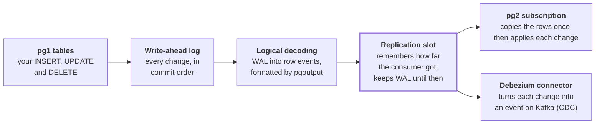

# 07 — Logical replication and change data capture

**The idea.** Lab 5 showed that every change is first written to the WAL. **Logical decoding** reads the WAL back and turns its low-level page changes into row-level events: "row inserted into `customers` with these values", "row updated", "row deleted". Those events can feed another Postgres database (**logical replication**) or an external system such as Kafka (**change data capture**, CDC, which is what Debezium does).

The moving parts, from source to consumer:

| Part | What it is |
| --- | --- |
| WAL | The log of every change (Lab 5). `wal_level=logical` (set in step 0.2) makes it detailed enough to rebuild rows. |
| Output plugin | Code that formats decoded changes. `test_decoding` writes readable text (for learning); `pgoutput` writes a binary protocol, used by Postgres's own replication and by Debezium. |
| Replication slot | A bookmark on the source: the WAL position up to which a consumer has confirmed receipt. Postgres keeps every WAL file after that position until the consumer catches up, so a consumer that was offline misses nothing. |
| Publication | On the source: the list of tables whose changes are published |
| Subscription | On the target: a connection to a publication. It copies the existing rows once, then applies changes as they stream in. |



Each consumer has its own slot. In this lab the consumer is pg2's subscription; Debezium would read the same decoded stream through a slot of its own, at its own pace.

This is different from **physical** replication, which copies the WAL byte for byte to an identical standby server. Logical replication sends rows, so the target can be a different Postgres version, hold only some tables, and accept its own writes, with consequences you will see in step 7.5.

**Where:** terminal A runs psql on pg1 (the source); terminal B runs psql on pg2 (the target). Run each block in the place its first line names.

## 7.1 Watch decoded changes with test\_decoding

In **terminal A**:

```bash
# Mac, terminal A
docker compose exec pg1 psql -U lab -d labdb
```

Create a slot that uses the readable `test_decoding` plugin, then make three changes:

```sql
-- pg1 psql, terminal A
SELECT * FROM pg_create_logical_replication_slot('demo_slot', 'test_decoding');

INSERT INTO customers (email, name, country) VALUES ('cdc@example.com', 'Cdc Test', 'US');
UPDATE customers SET country = 'MX' WHERE email = 'cdc@example.com';
DELETE FROM customers WHERE email = 'cdc@example.com';
```

- `pg_create_logical_replication_slot(name, plugin)` creates a slot that starts recording from the current WAL position.

**You should see** the slot's name and starting LSN (yours will differ), then `INSERT 0 1`, `UPDATE 1`, `DELETE 1`. Now read what the slot recorded:

```sql
-- pg1 psql, terminal A
SELECT lsn, xid, data FROM pg_logical_slot_peek_changes('demo_slot', NULL, NULL);
```

- `pg_logical_slot_peek_changes(slot, up_to_lsn, up_to_count)` returns the decoded changes **without** moving the bookmark. The two `NULL`s mean "no limit": read everything available.
- `xid` is the transaction id; `data` is the plugin's text.

**You should see** nine rows, three per statement (ids and timestamps yours), with `data` like:

```
BEGIN 965
table public.customers: INSERT: id[bigint]:10001 email[text]:'cdc@example.com' name[text]:'Cdc Test' country[character]:'US' created_at[timestamp with time zone]:'…'
COMMIT 965
BEGIN 966
table public.customers: UPDATE: id[bigint]:10001 email[text]:'cdc@example.com' name[text]:'Cdc Test' country[character]:'MX' created_at[timestamp with time zone]:'…'
COMMIT 966
BEGIN 967
table public.customers: DELETE: id[bigint]:10001
COMMIT 967
```

**What it means.**

- Each statement ran in its own transaction (autocommit), so each change is wrapped in `BEGIN` and `COMMIT` with that transaction's id. A consumer only ever receives changes from transactions that committed, in commit order.
- Every column comes with its name and type, for example `country[character]:'MX'`.
- The `UPDATE` event carries the **new** row only, and the `DELETE` carries only the primary key. By default the WAL does not keep the old values of a row; the next step changes that.

`peek` left the bookmark where it was. `get` reads **and** moves the bookmark past what it returned:

```sql
-- pg1 psql, terminal A
SELECT count(*) FROM pg_logical_slot_get_changes('demo_slot', NULL, NULL);
SELECT count(*) FROM pg_logical_slot_get_changes('demo_slot', NULL, NULL);
```

**You should see** `9`, then `0`: once consumed, the changes are gone from the slot.

## 7.2 Old values: REPLICA IDENTITY

**The idea.** A table's **replica identity** decides which old values the WAL records for an `UPDATE` or `DELETE`. The default records only the primary key, and only when it changes. `FULL` records the entire old row. CDC tools need `FULL` to report "before" values, at the price of more WAL per change.

```sql
-- pg1 psql, terminal A
ALTER TABLE customers REPLICA IDENTITY FULL;
UPDATE customers SET country = 'JP' WHERE id = 7;
SELECT data FROM pg_logical_slot_get_changes('demo_slot', NULL, NULL);
ALTER TABLE customers REPLICA IDENTITY DEFAULT;
```

**You should see** an empty `BEGIN`/`COMMIT` pair from the `ALTER TABLE` (schema changes are not decoded at all), then the update with both versions:

```
table public.customers: UPDATE: old-key: id[bigint]:7 … country[character]:'CA' … new-tuple: id[bigint]:7 … country[character]:'JP' …
```

**What it means.** `old-key:` is the row before the change (country CA) and `new-tuple:` the row after (country JP). This is where a CDC event's "before" value comes from. The last line sets the table back to the default.

## 7.3 A slot holds WAL until it is read

```sql
-- pg1 psql, terminal A
SELECT slot_name,
       plugin,
       active,
       pg_size_pretty(pg_wal_lsn_diff(pg_current_wal_lsn(), restart_lsn)) AS wal_kept_for_slot
FROM pg_replication_slots;

SELECT pg_drop_replication_slot('demo_slot');
```

- `pg_replication_slots` lists every slot. `active` says whether a consumer is connected right now. `restart_lsn` is the oldest WAL position the slot still needs; the distance from there to the current position is how much WAL the slot forces Postgres to keep.
- `pg_drop_replication_slot` deletes the slot.

**You should see** one row, `demo_slot | test_decoding | f | …` with a small size, then the slot dropped.

**What it means.** A slot never forgets. If its consumer disappears, the slot keeps every WAL file from that point on, the `pg_wal` folder grows until the disk is full, and VACUUM is held back as well (Lab 5). Always drop slots you no longer use. The setting `max_slot_wal_keep_size` caps how much WAL a slot may hold; past the cap Postgres gives up on that slot rather than fill the disk.

## 7.4 Replicate four tables from pg1 to pg2

**The idea.** Logical replication copies **rows**, never table definitions. So you first create the same tables on pg2, then publish on pg1 and subscribe on pg2.

**Step 1 — copy the table definitions.** Leave psql in terminal A for a moment:

```sql
-- pg1 psql, terminal A
\q
```

Then, in the same terminal, now at the Mac prompt:

```bash
# Mac, terminal A
docker compose exec -T pg1 pg_dump -U lab -d labdb --schema-only -t customers -t products -t orders -t order_items \
  | docker compose exec -T pg2 psql -U lab -d labdb
```

Line by line:

- `pg_dump` exports a database as SQL. `--schema-only` exports only definitions (`CREATE TABLE`, indexes, constraints), no rows. Each `-t name` limits it to one table.
- `|` is a pipe: the output of the first command becomes the input of the second.
- The second command runs psql on **pg2**, which executes the SQL coming down the pipe.
- `-T` tells `docker compose exec` not to set up an interactive terminal. A pipe needs this; without it the data can be garbled.
- The `\` at the end of the first line continues the command on the next line.

**You should see** a stream of `SET`, `CREATE TABLE` (4), `ALTER TABLE` and `CREATE INDEX` lines, and **no** `ERROR` lines.

**Step 2 — publish on pg1.** Reconnect to pg1 in **terminal A**:

```bash
# Mac, terminal A
docker compose exec pg1 psql -U lab -d labdb
```

Wait for the `pg1 labdb=#` prompt, then:

```sql
-- pg1 psql, terminal A
CREATE PUBLICATION shop_pub FOR TABLE customers, products, orders, order_items;
SELECT pubname, tablename FROM pg_publication_tables;
```

**You should see** `CREATE PUBLICATION`, then four rows, one per table, all under `shop_pub`.

**Step 3 — subscribe on pg2.** Open **terminal B**, `cd` to `pg-lab`, and connect to **pg2**:

```bash
# Mac, terminal B
docker compose exec pg2 psql -U lab -d labdb
```

Check that the prompt reads `pg2 labdb=#`, then:

```sql
-- pg2 psql, terminal B
CREATE SUBSCRIPTION shop_sub
    CONNECTION 'host=pg1 port=5432 user=lab password=lab dbname=labdb'
    PUBLICATION shop_pub;
```

- `CONNECTION '…'` is how pg2 reaches pg1. `host=pg1` works because Docker Compose gives each service its name on the containers' private network. Port 5432 is pg1's port **inside** that network; 55432 exists only on your Mac.
- Creating the subscription also creates a replication slot named `shop_sub` on pg1.

**You should see** `NOTICE:  created replication slot "shop_sub" on publisher`, then `CREATE SUBSCRIPTION`.

**Step 4 — watch the initial copy finish.** Each table is first copied in full, then switches to streaming changes:

```sql
-- pg2 psql, terminal B
SELECT pg_class.relname AS table_name,
       CASE pg_subscription_rel.srsubstate
            WHEN 'i' THEN 'initializing'
            WHEN 'd' THEN 'copying data'
            WHEN 'f' THEN 'copy finished'
            WHEN 's' THEN 'synchronized'
            WHEN 'r' THEN 'ready, streaming'
       END AS state
FROM pg_subscription_rel
JOIN pg_class ON pg_class.oid = pg_subscription_rel.srrelid
ORDER BY pg_class.relname;
```

- `pg_subscription_rel` has one row per subscribed table; `srsubstate` is a one-letter state code, translated into words by the `CASE`.
- It stores tables by internal id (`srrelid`), so the join to `pg_class` (the catalog of tables) looks up each table's name. `oid` is the internal id column in `pg_class`.

**You should see**, after a few seconds (repeat the query until it does), all four tables `ready, streaming`. Then compare the row counts:

```sql
-- pg2 psql, terminal B
SELECT (SELECT count(*) FROM customers)   AS customers,
       (SELECT count(*) FROM orders)      AS orders,
       (SELECT count(*) FROM order_items) AS order_items,
       (SELECT count(*) FROM products)    AS products;
```

**You should see** `10000 | 200000 | 400001 | 200`, the same as pg1.

**Step 5 — live changes.** In **terminal A** (pg1):

```sql
-- pg1 psql, terminal A
INSERT INTO customers (email, name, country) VALUES ('live@example.com', 'Live Row', 'ES') RETURNING id;
UPDATE orders SET status = 'paid' WHERE id = 100;
DELETE FROM order_items WHERE order_id = 200000;
```

In **terminal B** (pg2), a second later:

```sql
-- pg2 psql, terminal B
SELECT id, email FROM customers WHERE email = 'live@example.com';
SELECT status FROM orders WHERE id = 100;
SELECT count(*) FROM order_items WHERE order_id = 200000;
```

**You should see** the new customer with the same id pg1 returned, status `paid`, and `0` order lines. Inserts, updates and deletes all arrived within about a second.

**Step 6 — monitor both ends.**

```sql
-- pg1 psql, terminal A
SELECT application_name, state, sent_lsn, replay_lsn FROM pg_stat_replication;
```

**You should see** one row: `shop_sub | streaming |` and two equal LSNs. `sent_lsn` is how far pg1 has sent; `replay_lsn` how far pg2 has applied. When they are equal, pg2 is fully caught up.

## 7.5 Three things that go wrong

**Problem 1 — the id counter is not replicated.** Replication copies rows, not the identity counters that generate ids. On pg2, the `customers` counter still stands at its start. In **terminal B**:

```sql
-- pg2 psql, terminal B
INSERT INTO customers (email, name, country) VALUES ('local@example.com', 'Local', 'US');
```

**You should see** `ERROR:  duplicate key value violates unique constraint "customers_pkey"` with `DETAIL:  Key (id)=(1) already exists.` pg2 tried to use id 1, which arrived from pg1 long ago. Treat a subscriber's replicated tables as read-only. If a subscriber ever takes over as the main database, each counter must first be moved past the highest id.

**Why Postgres doesn't just use the highest id.** An identity column never looks at the table. It takes its next value from a separate counter object, a **sequence**, by asking it for its next number. The sequence only knows its own position, and on pg2 that position never moved: the replicated rows arrived with their ids already filled in by pg1, so pg2's counter was never asked. Logical replication in Postgres 17 copies rows, not sequence positions. Postgres uses a counter rather than "highest id + 1" on purpose: finding the highest id means reading the index, and two sessions doing it at the same moment would both pick the same number unless they locked each other out. A sequence hands out each number exactly once, instantly, without any locking. (It also means every failed attempt uses up a number: run the insert again and pg2 tries id 2.)

To look at the counter on pg2:

```sql
-- pg2 psql, terminal B
SELECT pg_get_serial_sequence('customers', 'id') AS sequence_name;
SELECT last_value, is_called FROM customers_id_seq;
```

`pg_get_serial_sequence(table, column)` returns the name of the sequence behind a column: `public.customers_id_seq`. `last_value` is the last number it handed out, and `is_called` says whether that number has been used yet. **You should see** a very small `last_value` (1, or 2 if you retried), far below the highest replicated id of about 10,000.

If pg2 ever had to take over from pg1, you would move each counter past the highest existing id first, with `setval`:

```sql
-- pg2 psql, terminal B (only when pg2 takes over; don't run it during the lab)
SELECT setval(pg_get_serial_sequence('customers', 'id'), (SELECT max(id) FROM customers));
```

`setval(sequence, value)` sets the counter's position, so the next insert gets `max(id) + 1`. Don't do this while replication is running: pg1 would later send a row with the same id, and the clash would stop replication, as Problem 2 shows.

**Problem 2 — a conflict stops replication.** If pg2 holds a row that clashes with an incoming change, applying that change fails, and **all** replication stops until the clash is removed. Create one on purpose. In **terminal B**:

```sql
-- pg2 psql, terminal B
INSERT INTO customers (id, email, name, country, created_at)
OVERRIDING SYSTEM VALUE
VALUES (20000, 'clash@example.com', 'Clash', 'US', now());
```

`OVERRIDING SYSTEM VALUE` lets you type your own id into a `GENERATED ALWAYS` column (the rule you met in step 1.3). Now insert the same email on **pg1**, in **terminal A**:

```sql
-- pg1 psql, terminal A
INSERT INTO customers (email, name, country) VALUES ('clash@example.com', 'From pg1', 'VE');
```

It succeeds on pg1. Wait a few seconds, then in **terminal B**:

```sql
-- pg2 psql, terminal B
SELECT subname, apply_error_count FROM pg_stat_subscription_stats;
```

**You should see** `apply_error_count` above 0, and it keeps growing if you repeat the query: pg2 retries about every 5 seconds and fails each time on the unique email. To read the error itself, open a third Mac terminal in `pg-lab`:

```bash
# Mac
docker compose logs pg2 --tail 20
```

**You should see** `ERROR:  duplicate key value violates unique constraint "customers_email_key"`, a `CONTEXT:` line saying it happened while processing remote data for `public.customers`, and a line saying the logical replication apply worker exited. Every change from pg1 is now queued behind this one. Remove the clash on pg2, in **terminal B**:

```sql
-- pg2 psql, terminal B
DELETE FROM customers WHERE id = 20000;
```

Wait about 5 seconds, then:

```sql
-- pg2 psql, terminal B
SELECT id, email, name FROM customers WHERE email = 'clash@example.com';
```

**You should see** the row from pg1, `name` = `From pg1`. The retry succeeded and replication resumed where it stopped.

**Problem 3 — a stopped consumer makes the source keep WAL.** Pause the subscription in **terminal B**:

```sql
-- pg2 psql, terminal B
ALTER SUBSCRIPTION shop_sub DISABLE;
```

Change some rows on pg1 and look at the slot, in **terminal A**:

```sql
-- pg1 psql, terminal A
UPDATE orders SET status = 'shipped' WHERE status = 'paid' AND id <= 50000;
SELECT slot_name,
       active,
       pg_size_pretty(pg_wal_lsn_diff(pg_current_wal_lsn(), confirmed_flush_lsn)) AS waiting_for_consumer
FROM pg_replication_slots;
```

- `confirmed_flush_lsn` is the position up to which the consumer has confirmed it applied the changes.

**You should see** `UPDATE 3501`, then `shop_sub | f |` with roughly 1.4 MB waiting. `f` (false) means no consumer is connected. Turn it back on, in **terminal B**:

```sql
-- pg2 psql, terminal B
ALTER SUBSCRIPTION shop_sub ENABLE;
```

Repeat the slot query in terminal A after a few seconds. **You should see** `active` = `t` and `0 bytes` waiting; pg2 has caught up.

**What it means.** A paused or broken consumer costs the source disk space, about 1.4 MB for 3,501 row changes here. At production volumes, a consumer down for a weekend can fill the source's disk. Alert on the size of `pg_replication_slots` lag, and set `max_slot_wal_keep_size`.

## 7.6 How Debezium uses the same machinery

Debezium's PostgreSQL connector is one more consumer of a replication slot. Instead of applying changes to another Postgres, it turns each change into an event and publishes it to Kafka. Every part of it maps onto what you just did:

| What you did in this lab | What Debezium does |
| --- | --- |
| Created a publication listing tables | Uses a publication (`publication.name`), created by Debezium or by you |
| A subscription created a slot on pg1 | Creates or reuses a slot (`slot.name`) with the `pgoutput` plugin (`plugin.name=pgoutput`) |
| The subscription copied the existing rows first | Takes an initial snapshot of the tables (`snapshot.mode`), then streams from the slot |
| `REPLICA IDENTITY FULL` added `old-key:` values | Fills the event's `before` field. With the default identity, `before` holds only the key, or nothing. |
| The paused subscription made pg1 keep WAL | A stopped connector makes the source keep WAL exactly the same way |
| The slot's position only moves when changes arrive | On a quiet database, a heartbeat (`heartbeat.interval.ms`) writes small periodic changes so the slot's position keeps moving and old WAL can be released |

The operational rules carry over unchanged: monitor slot lag, cap it with `max_slot_wal_keep_size`, set the replica identity deliberately for each table, and drop the slot when you retire a connector.

Leave both psql sessions open for the cleanup.

---

Previous: [06 — The query planner](06-query-planner.md) · [Back to the README](../README.md) · Next: [08 — How it fits together](08-how-it-fits-together.md)
