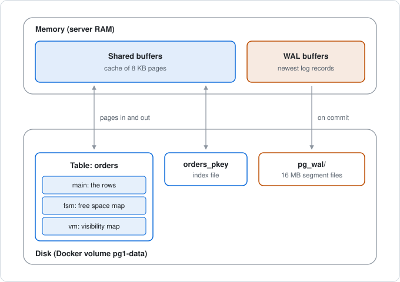
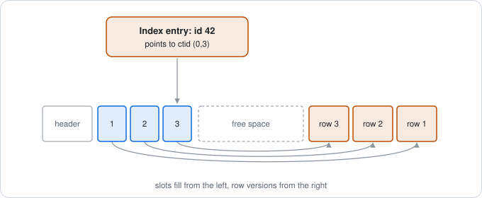

# 08 — How it fits together: tables, files, pages and memory

A reference for the whole lab: where data lives, how it moves between disk and memory, and which lab showed each piece.

## The layers, from big to small

| Level | What it is | Where you met it |
| --- | --- | --- |
| **Database** | `labdb`: a named collection of tables, in one directory of the server's data folder | Lab 0 |
| **Table** (and each **index**) | Stored as its own file(s) on disk. Postgres calls both a *relation*. | Labs 1–2 |
| **File** | One per relation, split into 1 GB pieces if it grows. Each table also has two small companion files, the free space map and the visibility map. | Labs 5–6 |
| **Page** (also called a *block*) | A fixed **8 KB** slice of a file. Postgres always reads, caches and writes whole pages, never single rows. | `relpages` = 1,482 for `orders` (step 6.1) |
| **Row version** (tuple) | One version of one row, stored inside a page and stamped with `xmin` and `xmax` | Lab 4 |

## Memory and disk

How the pieces work together:

1. **Reading.** A query never reads a row straight from disk. It asks for the page that holds the row. If the page is already in **shared buffers**, that is a `hit` in `Buffers: shared hit=…`. If not, Postgres reads the 8 KB page from the file into shared buffers first, which `EXPLAIN` shows as `read=`. Index pages are cached the same way.
2. **Changing.** An `UPDATE` changes the page **in memory** only, and the page becomes "dirty". At the same moment, a description of the change goes into the **WAL buffers**.
3. **Committing.** At `COMMIT`, the WAL buffers are written to the **WAL files** in `pg_wal/`. Once that is on disk the transaction is safe, even though the changed table page may still exist only in memory.
4. **Writing pages later.** Background processes write dirty pages back to the table and index files at their own pace. A **checkpoint** forces all of them out, so crash recovery only has to replay WAL written after it (Lab 5).
5. **After a crash.** Memory is lost; the files survive. Postgres replays the WAL from the last checkpoint onto the data files, using full-page images to repair torn pages (step 5.3).

The two small companion files of each table:

| File | Tracks | Used by |
| --- | --- | --- |
| **fsm** (free space map) | How much free space each page has | `INSERT` and `UPDATE`, to find a page with room. VACUUM fills it in after freeing space (step 5.5). |
| **vm** (visibility map) | Which pages are "all visible": every row on them visible to everyone | Index-only scans, to skip the table (step 6.4). Only VACUUM sets these marks. |

## Inside one page

This is the level where MVCC, pruning and `ctid` live:

- **Header:** a small area at the start of the page, holding things like the LSN of the page's last change.
- **Slots** (line pointers): a small table of contents at the start of the page. Slot 3 says where on the page row version 3 is stored.
- **Row versions:** the actual data, stacked from the end of the page backwards, each with its `xmin`/`xmax` stamps (Lab 4).
- **Free space:** the gap in the middle, which shrinks as slots and rows are added from both ends.

**`ctid` ties it all together.** `ctid = (page, slot)` is a row version's physical address: (0,3) means page 0 of the file, slot 3. Index entries store exactly this address, so an index lookup is "find the key in the index, then go to that page and slot".

## How the lab's events map onto these pictures

| Event | What happens to pages, files and memory | Lab |
| --- | --- | --- |
| `UPDATE` | A new row version is written; the old one stays on the page as a dead version | 4 |
| Pruning | A query removes dead versions from **one page** in memory, keeping the slots | 5.3 |
| `VACUUM` | Walks every page: removes dead versions, cleans index entries pointing at them, updates the fsm and vm. The file does not shrink. | 5.5 |
| `VACUUM FULL` | Copies live rows into a **new file**, deletes the old one, and gives the space back to the operating system | 5.5 |
| Full-page image | The first change to a page after a checkpoint copies the whole page into the WAL, skipping the free-space gap | 5.3 |
| Checkpoint | Writes every dirty page in shared buffers to the table and index files | 5.3 |
| Seq Scan | Reads every page of the main file in order (1,482 for `orders`) | 6.1 |
| Index Scan | Walks the index file's pages, then visits each row's page by `ctid` | 6.4 |
| Index-only scan | Reads the index, and consults the vm to skip table pages | 6.4 |
| Bitmap heap scan | Collects the `ctid`s first, then reads each needed table page once, in file order | 6.3 |

**Where the files physically live.** Inside the pg1 container, all of this sits in `/var/lib/postgresql/data`, which is the Docker volume `pg1-data` from your Compose file. Table and index files are in `base/<database number>/`, WAL files in `pg_wal/`. That is why the data survives `docker compose down` and is erased by `down -v`.

---

Previous: [07 — Replication and CDC](07-replication-cdc.md) · [Back to the README](../README.md) · Next: [Cleanup and troubleshooting](cleanup-and-troubleshooting.md)
